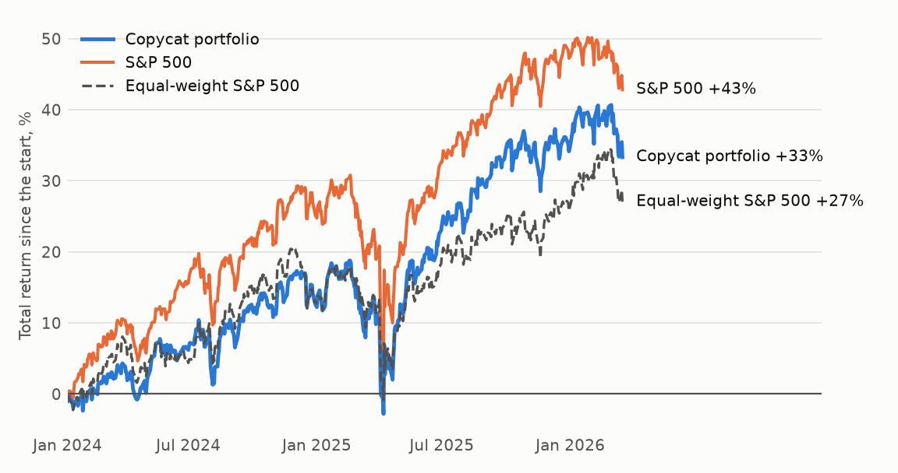
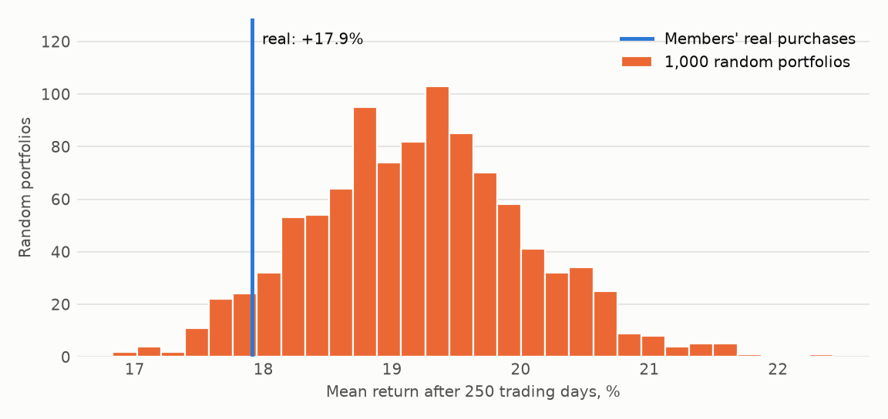

# Capitol Trades Engine (main repo is private)

I built a small engine that runs a big job as many small tasks and still gives the right answer while I keep killing its parts. Then I used it on a real question: do members of the U.S. House beat the stock market with their trades?

Short answer: the engine survived every crash, and no, they did not beat the market.

## Why this question

Stories about politicians and their stock trades come up in the news again and again, and there are whole websites for copying those trades. I wanted to see what the data says. So I looked for published research on the topic and repeated its methods on the newest House filings.

## The idea

A normal script that dies at file 700 of 966 starts again from file 1, or worse, counts some results twice. This engine writes down every finished task in Postgres, so after a crash it does only the rest, and every result is saved exactly once.

```
  workers (Python)  ──gRPC──▶  2 coordinators (Go)  ──▶  Postgres (queue + state)
```

- **Leases.** A worker borrows a task for a few seconds and must keep saying "I am alive". If it goes quiet, another worker gets the task.
- **Fencing token.** Every lease has a number. A worker that froze and woke up later has an old number, so its write is refused.
- **No leader.** Two coordinators run at the same time and keep nothing in memory. Kill one and the other continues.

More detail: [docs/design.md](docs/design.md). Why I chose each thing: [docs/decisions/](docs/decisions/). Bugs the tests found: [docs/bugs.md](docs/bugs.md).

## Does it really survive?

A test program kills workers, kills coordinators, restarts the database and freezes workers while a job runs. Then it compares the result with a calm run of the same job.

| | |
| --- | --- |
| Runs with the correct result | **200 of 200** (1,406 faults injected) |
| Late writes from "zombie" workers refused | **867** |
| Time to recover after a worker is killed | **6.2 to 6.8 s** |
| Speed on one laptop | **24 / 89 / 159 tasks per second** with 1 / 4 / 16 workers |

One run looks like this:

```
run 1 (seed 1)
   1.1s  coordinator_kill   kill     capitol-coordinator-1-1
   2.3s  worker_kill        kill     capitol-worker-6
   4.2s  postgres_restart   restart  capitol-postgres-1
   5.3s  zombie             pause    capitol-worker-2
  ok in 29s: stale rejected 2, expiries 3, hash d578c0a24404
```

Full results: [docs/chaos-results.md](docs/chaos-results.md).

## What the data showed

The pipeline read 966 public trade reports from 2024 and 2025 and got 8,957 stock trades. I then repeated methods from four published papers on politicians' trading.

**Copying their trades lost to the index.** Buy what a member bought on the day it becomes public, hold 60 days:



**Random stocks did as well.** I replaced every purchase with a random stock of the same sector and similar size, 1,000 times. After one year the real purchases were near the bottom:



| Question (purchases, one year after the trade) | Result | 95% interval |
| --- | --- | --- |
| Against the S&P 500 | -1.4% | -4.5% to +2.1% |
| Against the equal-weight S&P 500 | +4.8% | +1.5% to +8.3% |
| Stocks in industries of the member's own committee, against the same industries bought by others | -1.5% | -6.0% to +3.7% |

- **No edge.** Most intervals include zero.
- **The benchmark decides the story.** A few huge AI companies carried the S&P 500 in these years. Against an index where every company has the same weight, the purchases look fine.
- **No committee advantage.** Sitting on the committee that oversees an industry did not help.

All numbers and the weak points: [docs/research-results.md](docs/research-results.md). These are averages over groups. They say nothing about any person and cannot show intent.

## Sources

The finance checks follow these papers. I used their methods on newer House data; I did not copy their code or data.

| Paper | What I took from it |
| --- | --- |
| Belmont, Sacerdote, Sehgal, Van Hoek (2022). [Do senators and house members beat the stock market? Evidence from the STOCK Act](https://doi.org/10.1016/j.jpubeco.2022.104602). *Journal of Public Economics* 207. Free version: [NBER w26975](https://www.nber.org/papers/w26975) | The main question, purchases and sales kept apart, and the random picker test |
| Eggers, Hainmueller (2013). [Capitol Losses: The Mediocre Performance of Congressional Stock Portfolios](https://doi.org/10.1017/S0022381613000194). *The Journal of Politics* 75(2) | The copycat portfolio (a portfolio followed day by day) and the home-state check |
| Abdurakhmonov, Snider, Ridge, Hasija (2023). [Perceptions of political self-dealing? An empirical investigation of market returns surrounding the disclosure of politician stock purchases](https://doi.org/10.1002/smj.3459). *Strategic Management Journal* 44(5) | The committee match and the price move on the disclosure day. Their data is the Senate; I tested the House |
| Wei, Zhou (2025). ["Captain Gains" on Capitol Hill](https://www.nber.org/papers/w34524). NBER Working Paper 34524 | Background only. It compares party leaders with other members; I did not repeat it, because that would mean naming people |

Data:

- Trade reports: [Clerk of the House, financial disclosure](https://disclosures-clerk.house.gov/FinancialDisclosure)
- Committee lists and House terms: [unitedstates/congress-legislators](https://github.com/unitedstates/congress-legislators)
- Prices, sectors and company size: Yahoo Finance, read with the `yfinance` library

## Run it

You need Docker, Go and Make. Nothing is downloaded: the demo uses 20 real filings saved in the repo.

```bash
make demo
```

It starts Postgres, two coordinators and six workers, runs the pipeline and breaks things while it runs. Watch it live at <http://localhost:8081>.

| Command | What it does |
| --- | --- |
| `make test` | Go and Python tests |
| `make test-integration` | Kills and freezes real containers |
| `make chaos N=100` | 100 chaos runs on a toy job |
| `make research` | The finance checks and the full report (needs the full data, not in git) |
| `make down` | Stop everything and delete the data |


## Data rules

Filings come from the [Clerk of the House](https://disclosures-clerk.house.gov/FinancialDisclosure). The law forbids using them for commercial purposes, credit ratings or asking for money (5 U.S.C. app. § 105(c)). This is a non-commercial study project; the site was read once, slowly. No member is named or ranked. Details: [docs/data-notes.md](docs/data-notes.md).

## Where things are

```
coordinator/         Go: the engine, all SQL, gRPC server
sdk/                 Python: @task, worker loop
pipeline/            Python: the real tasks, PDF parser, finance checks
chaos/               Go: fault injector and result checker
tests/integration/   tests that kill real containers
snapshots/           saved inputs, so runs repeat exactly
docs/                design, decisions, bugs, results
```
